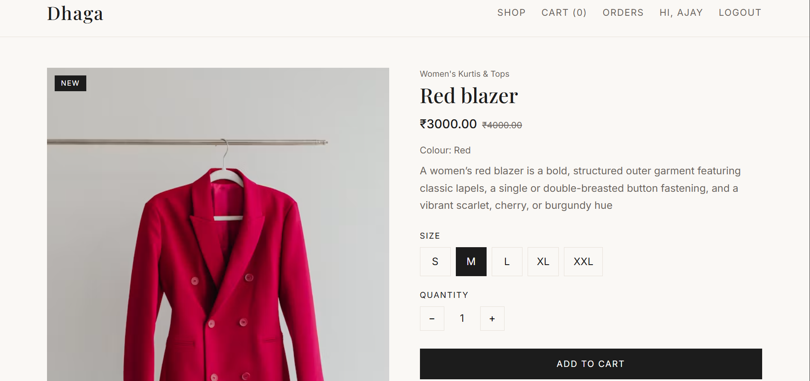
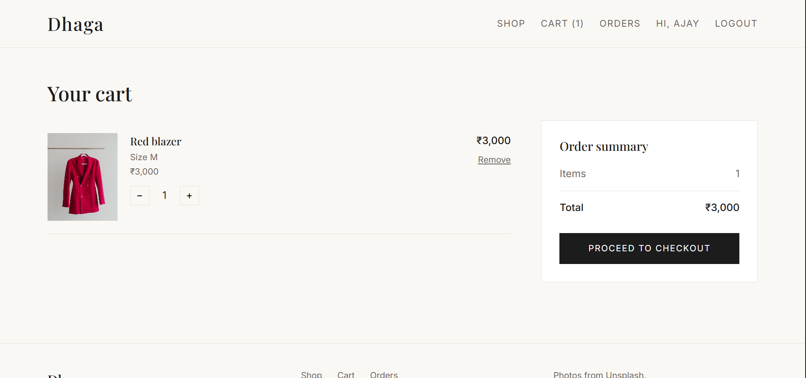
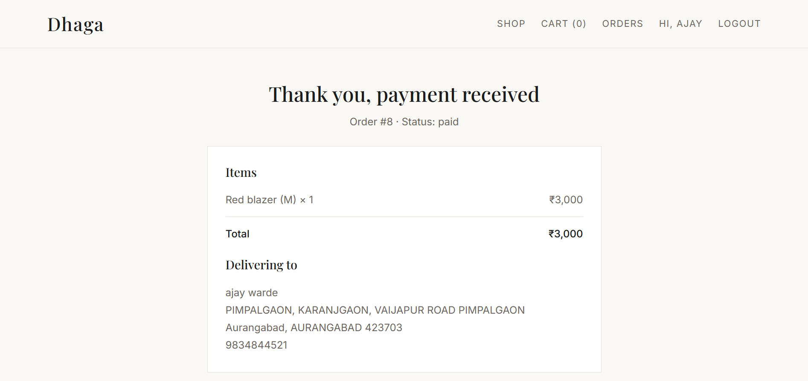

# Dhaga

A full-stack clothing store built with React, Django REST Framework and MySQL, with JWT login and Razorpay payments (test mode).

**Live demo:** _coming soon_

> This is a demo store. Payments run in Razorpay test mode, so no real money is charged.

## Screenshots

| Home | Product page |
|---|---|
|  |  |

| Cart | Payment |
|---|---|
|  |  |



## Features

- Browse products with category filter, search, size filter, sorting and pagination
- Product page with size selection and live stock per size
- Register and log in with JWT (access and refresh tokens, automatic token refresh)
- Cart stored on the server, with stock checks on every change
- Checkout with delivery details and server-side validation
- Razorpay payment with signature verification on the backend
- Order history with Pay now and Cancel (cancelling restores stock)
- Django admin to manage categories, products, stock and order status

## Tech stack

| Layer | Technology |
|---|---|
| Frontend | React (Vite), React Router, React-Bootstrap, Axios |
| Backend | Python, Django, Django REST Framework |
| Database | MySQL |
| Auth | JWT (SimpleJWT) |
| Payments | Razorpay (test mode) |

## How an order works

1. The customer checks out and the server creates the order as `pending`, reducing stock inside a database transaction.
2. The backend creates a Razorpay order and the React app opens the Razorpay popup.
3. After payment, Razorpay returns a payment id and a signature.
4. The backend verifies the signature with the secret key and marks the order `paid`.
5. If the customer leaves without paying, the order stays `pending`. They can pay later or cancel, which restores the stock.

## API overview

| Method | Endpoint | Description |
|---|---|---|
| GET | `/api/categories/` | List categories |
| GET | `/api/products/` | List products (`category`, `size`, `search`, `ordering`, `page`) |
| GET | `/api/products/<slug>/` | Product detail |
| POST | `/api/auth/register/` | Create an account |
| POST | `/api/auth/login/` | Get access and refresh tokens |
| POST | `/api/auth/token/refresh/` | Get a new access token |
| GET | `/api/auth/me/` | Current user |
| GET | `/api/cart/` | Current cart |
| POST | `/api/cart/items/` | Add an item |
| PATCH / DELETE | `/api/cart/items/<id>/` | Change quantity / remove |
| GET / POST | `/api/orders/` | List orders / place an order |
| GET | `/api/orders/<id>/` | Order detail |
| POST | `/api/orders/<id>/pay/` | Start a Razorpay payment |
| POST | `/api/orders/<id>/verify/` | Verify the payment signature |
| POST | `/api/orders/<id>/cancel/` | Cancel a pending order |

## Run it locally

**Requirements:** Python 3.11+, Node 18+, MySQL 8

### Backend

```bash
cd backend
python -m venv venv
venv\Scripts\activate
pip install -r requirements.txt
copy .env.example .env
```

Create the database in MySQL:

```sql
CREATE DATABASE dhaga_db CHARACTER SET utf8mb4 COLLATE utf8mb4_unicode_ci;
```

Edit `.env` with your MySQL password, a Django `SECRET_KEY` and your Razorpay **test** keys, then:

```bash
python manage.py migrate
python manage.py createsuperuser
python manage.py runserver
```

Open `http://127.0.0.1:8000/admin/` and add categories, products and sizes with stock.

### Frontend

```bash
cd frontend
npm install
npm run dev
```

Open `http://localhost:5173`.

## Project structure

```
dhaga/
  backend/    Django project (config, products, accounts, orders)
  frontend/   React app (pages, components, auth and cart context)
  docs/       Screenshots
```

## What I learned

- Designing relational tables (products, sizes, carts, orders) and keeping stock correct with transactions
- Token-based authentication and refreshing expired tokens
- Verifying payments on the server instead of trusting the browser

## Next improvements

- Razorpay webhooks, so payments are confirmed even if the browser closes
- Order confirmation emails with Celery
- Automated tests and Docker